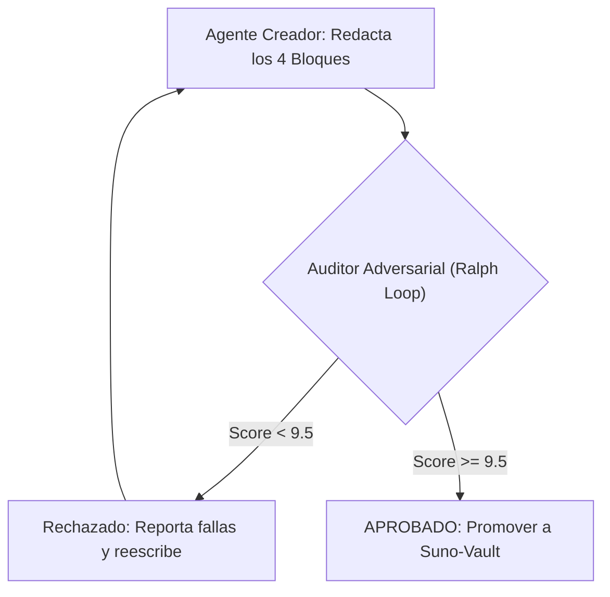

# Suno Prompter — Skill Maestra para Suno AI v6

Esta skill define la metodología universal y determinista de prompt engineering para sintetizar canciones profesionales en **Suno AI v6** utilizando el **Modo Avanzado / Custom Mode**.

---

## 1. El Paradigma Fundamental de Suno V6

> **"Dirige a los músicos, no describas el disco."**  
> Suno V6 no responde a adjetivos estéticos o deseos (*"crisp, radio-ready, masterpiece"*). V6 interpreta el texto de forma literal y ejecuta instrucciones físicas: qué toca cada instrumento, cómo canta la voz en cada sección y dónde se colocan los elementos en el espacio sonoro.

### Los Tres Mandamientos Técnicos de V6:
1. **`Variety = 0` Siempre:** Si el slider `Variety > 0`, Suno reescribe silenciosamente tu prompt antes de sintetizar. Fijar `Variety = 0` retiene el control estricto de las etiquetas.
2. **Arquitectura Espejada (Style $\leftrightarrow$ Lyrics Cues):** Lo que declares en el casillero de estilo debe reforzarse palabra por palabra con metatags entre corchetes al inicio de cada sección en la letra.
3. **Negaciones solo en Exclusiones:** Jamás escribas *"no humming"*, *"no drums"* o *"no vocals"* en el estilo; eso activa el concepto. Toda negación va en el casillero `Exclude Styles`.

---

## 2. Los 4 Casilleros Obligatorios de Salida

Para cada producción, el agente debe generar obligatoriamente estos 4 bloques de texto independientes:

### Bloque 1: Título y Parámetros (Title Box)
Formato estricto para trazabilidad y pruebas A/B:
```text
[I|V] {título} {take} [Max] W:{w} S:{s} A:{a} V:{v} {modelo}
```
* **`I` / `V`**: `I` para Instrumental, `V` para Vocal.
* **`{título}`**: Nombre corto del track en minúsculas.
* **`{take}`**: Número de variación o toma (`1`, `2`, `3`...).
* **`Max`**: Solo si se activa *Max Mode* (obligatorio para tracks > 2 min o keepers finales).
* **`W:{w}`**: *Weirdness* (`20 - 30` para estabilidad y calidez analógica; `50` neutral).
* **`S:{s}`**: *Style Influence* (`75 - 85` para obediencia estricta del prompt).
* **`A:{a}`**: *Audio Influence* (`50 - 75` si se adjunta audio/nota de voz).
* **`V:{v}`**: *Variety* (estrictamente `0` para respetar las etiquetas del usuario).
* **`{modelo}`**: `v6` (precisión), `v6-wild` (carácter orgánico o géneros saturados) o `v6-mini` (borradores).

*Ejemplo:* `V midnight drive 1 Max W:20 S:85 A:50 V:0 v6`

---

### Bloque 2: Casillero de Estilo (Style of Music Box)
Límite duro estricto: **$\le 1000$ caracteres** (el sweet spot de las canciones destacadas es de 250 a 650 caracteres).  

> [!IMPORTANT]
> **Regla de Oro de Elementos Puros (Cero Estructura en el Style Box):**  
> El casillero Style of Music **NUNCA debe contener la estructura de la canción** (ej. *"Intro 16 bars, Drop 24 bars, Outro for 32 bars"*). La estructura vive exclusivamente en el casillero de letra (Lyrics Box) a través de los metatags de sección. El Style Box es exclusivamente para la fórmula tímbrica: géneros, BPM, escala, paleta instrumental y capa de producción de mezcla.

Debe seguir rigurosamente este **orden sintáctico de 7 pasos**:

$$\text{1. Género/BPM/Key} \longrightarrow \text{2. Voz} \longrightarrow \text{3. Batería} \longrightarrow \text{4. Guitarras/Sintes} \longrightarrow \text{5. Bajo} \longrightarrow \text{6. Producción Pro} \longrightarrow \text{7. Textura}$$

#### Las 6 Dimensiones de la Capa de Producción Pro:
Toda fórmula de estilo debe concluir con la directiva `Production:` cubriendo:
1. **Colocación Vocal:** Posición física de la voz (*"close-miked and dry in front of the band, loudest element, instruments sit behind and below the voice"*).
2. **Low-End Ownership:** Quién domina los graves (*"kick and sub-bass locked"* o *"808 carries bottom under short click kick"*).
3. **Sala y Espacio:** Acústica (*"intimate dry studio booth"* o *"big live room"*).
4. **Ancho Estéreo:** Paneo (*"narrow verse opening into wide glossy chorus, double-tracked guitars panned wide"*).
5. **Textura/Era:** Carácter analógico (*"warm tape saturation, 1970s analog console"*).
6. **Rango Dinámico:** Contraste (*"quiet-to-heavy dynamic lift into chorus"*).

*Ejemplo de Style Box Completo:*
```text
Indie Rock, 124 BPM, 4/4, key of E minor.
Female lead, gritty and intimate, close-miked and dry in front of the band, sings conversationally in verses, pushes with full belt on chorus.
Live drums with tight snare, quiet in verse, driving four-on-the-floor beat with crash fills in chorus.
Electric rhythm guitar plays continuous palm-muted arpeggio under the verse vocal, never stops. Chorus opens into a wall of double-tracked distorted guitars.
Melodic bass walks through chord changes, drops out for first two bars of bridge.
Arrangement: 4-bar guitar intro, quiet verse, wide loud chorus, dynamic bridge, clean hard stop on final chord.
Production: lived-in studio mix, vocal centered and loudest, tight punchy low end, warm analog tape saturation.
```

#### Inyección de Hardware y Timbre Electrónico (Dance / Techno / House):
Para cualquier track de música electrónica de club, **está estrictamente prohibido usar etiquetas genéricas** como *"club beat"*, *"electronic synth"* o *"techno bass"*. El agente **debe consultar obligatoriamente** el glosario [`dance-techno-house-sound-glossary.md`](references/dance-techno-house-sound-glossary.md) e inyectar términos de hardware y síntesis física:
* **Kick específico:** `punchy 909 kick` (Tech House), `industrial rumble kick` (Peak Time Techno), `808 sub kick` (Deep House), `short click kick` (Minimal).
* **Hats y Platillos:** `off-beat 909 open hat`, `tight closed 909 hats`, `driving 909 ride cymbal`, `reverse cymbal swell`.
* **Cajas y Palmas:** `layered 909 clap on 2 and 4`, `snappy 808 snare`, `organic wood rimshot`.
* **Bajo de Club:** `303 acid bassline with screaming filter resonance and slides`, `deep rolling reese bassline`, `hollow FM donk pluck bass`, `moog sub-bass locked with kick`, `arpeggiated SH-101 bassline`.
* **Sintes e Instrumentos Líderes:** `korg m1 organ stab`, `dub techno chord stabs`, `rave hoover synth`, `plucky melodic synth`, `modular bleeps`.
* **Cues Espejados en Letra:** Reflejar las mismas máquinas en las secciones: `[Intro - 909 kick and sub-bass groove, 16 bars]`, `[Breakdown - kick drops out, 303 acid lead opens cutoff, white noise riser]`, `[Drop - full industrial rumble kick, driving 909 ride, screaming acid modulation]`.

---

### Bloque 3: Casillero de Exclusiones (Exclude Styles Box)
Filtro negativo conciso. **Reglas:** menos de 8 a 10 categorías, solo sustantivos o familias instrumentales, jamás oraciones completas ni cualidades abstractas (*"loud", "bad"*).

*Ejemplo Estándar:*
```text
EDM, Big Room, Acoustic Guitar, Orchestral Strings, Country Banjo, Heavy Metal Screams, Brass Section, Humming, Vocal Textures Before Verse
```

---

### Bloque 4: Casillero de Letra y Estructura (Lyrics Box)
Desglose cronológico de secciones (`[Intro]`, `[Verse]`, `[Pre-Chorus]`, `[Chorus]`, `[Bridge]`, `[Outro]`, `[End]`).

**Reglas Críticas de Letrística V6:**
1. **Section Cues Espejados:** Cada tag debe incluir la instrucción de instrumentación acordada con el estilo:  
   `[Verse 1 - riff continues under vocal, palm-muted, drums quiet]`
2. **Pacing y Balance Silábico:** 6 a 8 sílabas por verso en baladas y pop melódico; 10 a 14 en rap/urbano.
3. **Elongación de Vocales:** Escribir las vocales estiradas en el papel para forzar el sostenido melódico:  
   `"Sta-a-ay, just one more ni-i-ight"`
4. **Uso de Paréntesis y Corchetes:**
   - `[Corchetes cuadrados]`: Directivas técnicas para el motor (NO se cantan).
   - `(Paréntesis redondos)`: Letra que SÍ se canta (segundas voces, ecos, coros, ad-libs).
5. **Cero Números en Dígitos:** Escribir siempre fonéticamente (*"twenty-four seven"* en vez de *"24/7"*).
6. **Tag `[Silence]` Inline:** Para evitar líneas apresuradas o cantadas con prisa, colocar `[Silence]` al final del verso sin puntuación previa.
7. **Límite Físico de 5000 Caracteres (Gate 7 Anti-Trimming):** Suno recorta automáticamente cualquier texto que supere 5,000 caracteres (*"We trimmed your paste to fit the 5000-character limit"*), perdiendo los outros y metatags de parada final. La letra con metatags debe mantenerse estrictamente $\le 5000$ caracteres (sweet spot: 2,500 a 4,200 caracteres para club mixes extendidos). Evitar repetir el catálogo completo de estilos en cada sección.

---

## 3. Protocolo Adversarial Ralph Loop V6 (>= 9.5 / 10.0)

Todo track generado debe evaluarse contra la **Rúbrica de 7 Filtros Adversariales**:



### Los 9 Filtros Obligatorios (Ralph Loop 9D):
1. **Filtro de Variety:** ¿El preset garantiza `Variety = 0` explícitamente?
2. **Filtro de Veredicto:** ¿Se eliminaron palabras inútiles (*crisp, clear, radio-ready, professional, mastered*)?
3. **Filtro de Continuidad de Banda:** ¿El casillero de estilo y el cue de la estrofa garantizan que el instrumento rítmico principal continúe tocando bajo la voz?
4. **Filtro de Colocación Vocal:** ¿La voz tiene directiva física de mezcla (*"in front of the band, close-miked and dry"*)?
5. **Filtro de Espejo (Style $\leftrightarrow$ Cues):** ¿Los metatags de la letra coinciden con el casillero de estilo?
6. **Filtro de Exclusiones Negativas:** ¿El casillero `Exclude` tiene menos de 10 categorías y ninguna oración completa?
7. **Filtro de Bordes:** ¿La intro y el outro tienen compases o directiva explícita de parada (*hard stop / held chord*)?
8. **Filtro de Fidelidad Temporal (Anti-Complacencia Matemática):** Si el usuario solicitó una duración específica (ej. 4:30), ¿la suma de compases coincide matemáticamente con dicho tiempo a los BPM fijados ($\text{Compases} = \text{Segundos} \times \frac{\text{BPM}}{240}$)? Prohibido asumir colas de reverberación o fadeouts de DJ para esconder desfases $> 5\text{s}$. Ante discrepancias, activar protocolo interactivo con el usuario (grill-me) proponiendo extensiones de sección.
9. **Filtro de Elementos Puros y Límite de 1000 Caracteres en Style Box:** ¿El Style Box mide estrictamente $\le 1000$ caracteres y carece de nombres de sección o compases (`bars`, `intro`, `break`, `drop`, `outro`)? Toda la estructura debe vivir en el casillero de letra.
10. **Filtro de Letra $\le 5000$ Caracteres (Gate 7 Anti-Trimming):** ¿El texto completo del casillero de letra mide estrictamente $\le 5000$ caracteres para evitar el recorte destructivo de la interfaz de Suno?
11. **Filtro de Historial de Versiones (Stacking Colapsable):** ¿Toda actualización de prompt preserva las versiones anteriores en bloques `<details><summary>📦 Versión X</summary>...</details>` en la Sección 7, manteniendo la versión más reciente activa y visible al inicio de la nota?

---

## 4. Guías de Referencia en `references/`

Consulta los documentos adjuntos especializados para cada dimensión de producción:
* [slider-presets-matrix.md](references/slider-presets-matrix.md) — Calibración paramétrica de W/S/A/V y comparativa de modelos.
* [pro-production-layers.md](references/pro-production-layers.md) — Las 6 dimensiones de mezcla y colocación espacial.
* [problem-fix-quick-triage.md](references/problem-fix-quick-triage.md) — Diagnóstico y corrección en 90 segundos para fallos en V6.
* [anti-patterns-v6-checklist.md](references/anti-patterns-v6-checklist.md) — Lista negra de los 23 errores fatales de prompt en Suno V6.
* [micro-metatags-syntax.md](references/micro-metatags-syntax.md) — Descriptores por sección para música de club y electrónica.
* [club-bar-structures.md](references/club-bar-structures.md) — Arreglos con cómputo de compases exactos.
* [exclude-styles-database.md](references/exclude-styles-database.md) — Banco canónico de exclusiones por subgénero.
* [dance-techno-house-sound-glossary.md](references/dance-techno-house-sound-glossary.md) — Glosario enciclopédico de sonidos, kicks, hats, baixos 303/Reese, cajas de ritmo y sintes para club.
