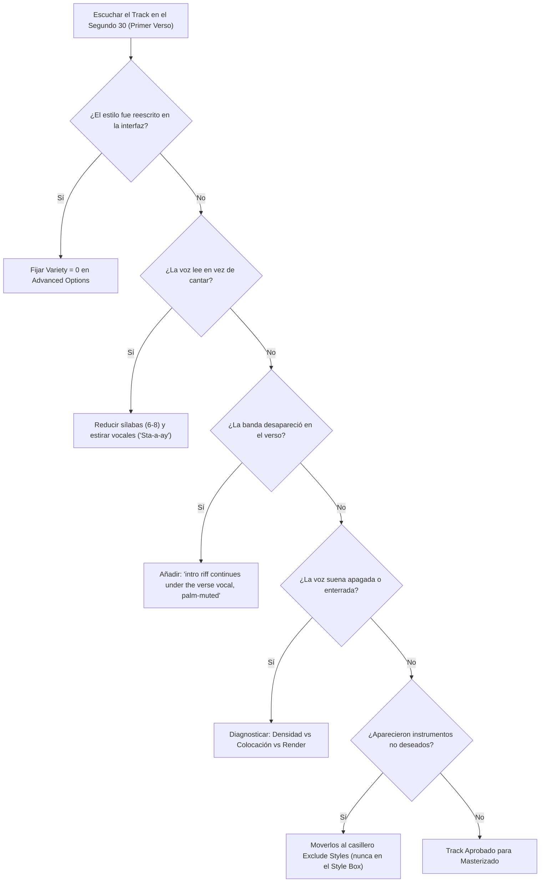

# Matriz de Diagnóstico Rápido en 90 Segundos para Suno V6

Cuando una generación en Suno V6 no suena como se esperaba, utiliza este protocolo de triaje en lugar de gastar créditos en regeneraciones aleatorias:

---

## 1. El Árbol de Decisión de 90 Segundos

---

## 2. Tabla de Fallos Comunes y Corrección Inmediata

| Síntoma en V6 | Causa Raíz | Solución Inmediata en 1 Paso |
|---|---|---|
| **Mi prompt de estilo aparece cambiado** | El slider `Variety` está activo y reescribió las etiquetas. | Configurar `Variety = 0` bajo *Advanced Options*. |
| **El cantante lee la letra de forma robótica** | Demasiadas sílabas por compás o vocales no estiradas. | Cortar sílabas a 6-8 por línea y graficar la vocal sostenida (`"Sta-a-ay"`). |
| **Estrofa y coro suenan con la misma energía** | Falta de contraste físico en el prompt y letra. | Hacer el verso íntimo y seco (`close-miked, dry`) y el coro amplio y pleno (`full band, wide stereo`). |
| **En duetos, los cantantes se cambian a mitad de frase** | Asignación ambigua o frases demasiado largas. | Nombrar `Singer A` y `Singer B`, etiquetar cada sección y limitar intercambios a $\le 6$ sílabas. |
| **La banda se apaga cuando entra la voz (Rock)** | El riff solo se pidió en la intro y nadie le dio órdenes en el verso. | Indicar en el estilo: *"The intro riff continues under the verse vocal, palm-muted and lower, never stops"*. |
| **Pedí solo guitarra acústica y entró una banda completa** | Se usó *"Instrumental"* en vez de *"Solo performer"*. | Describir *"One acoustic guitar, single performer alone in a quiet room"*, vaciar letra y llenar `Exclude`. |
| **Hay tarareos (`humming`) o ad-libs antes del verso** | Se dejó la intro sin instrucciones o se escribió *"no humming"* en el estilo. | Definir compases exactos de intro y colocar `humming, vocal intro, ad-libs` en `Exclude Styles`. |
| **El tema dura demasiado o corta la última frase** | La letra es muy extensa para el tiempo asignado. | Reducir letra, indicar duración objetivo (*"Total song under 3:15"*) y cerrar con `[End - hard stop]`. |
| **La voz suena encajonada o lejana** | Conflicto de frecuencias medias o colocación detrás de la banda. | Usar: *"vocal in front of the band, close-miked and dry, instruments sit behind and below the voice"*. |
| **El género suena plano y sin fuerza (`v6`)** | Compresión excesiva de `v6` en géneros densos (Metal/DnB). | Cambiar el modelo a **`v6-wild`** con `Weirdness: 20` y `Style Influence: 80`. |
