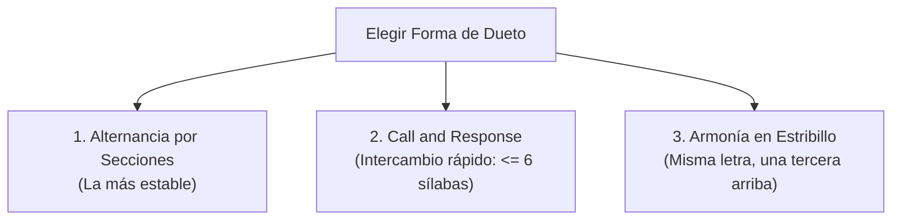

# Arquitectura de Duetos y Asignación de Líneas en Suno V6

En Suno V6, el intercambio desordenado de voces a mitad de frase no es un defecto del modelo; es un problema de **asignación ambigua**. Si no declaras explícitamente quién canta cada compás, el modelo toma una decisión probabilística distinta en cada generación.

---

## 1. Las Tres Formas Canónicas de Dueto

Antes de escribir una sola línea de letra, debes elegir **una y solo una** de estas tres estructuras:



---

### Forma 1: Alternancia por Secciones Completas (Easiest & Most Stable)
Un cantante toma una estrofa completa; el otro toma la siguiente. En el coro se unen o se alternan.

**En el Casillero de Estilo:**
```text
Two singers. Singer A: male, low baritone, plain and unhurried. Singer B: female, warm alto, sings a little behind the beat. Each verse is sung by one singer alone, never both. Verse 1 Singer A only. Verse 2 Singer B only. Chorus both singers in unison.
```

**En el Casillero de Letra:**
```text
[Verse 1 - Singer A only]
I kept the porch light burning, kept the coffee on
Waiting for the gravel to tell me that you're home

[Verse 2 - Singer B only]
I kept the headlights cutting through the heavy rain
Wondering if the porch light was burning through the pain

[Chorus - Singer A and Singer B]
Sta-a-ay, just one more ni-i-ight
```

---

### Forma 2: *Call and Response* / Diálogo Rápido (Líneas $\le 6$ Sílabas)
Los cantantes se responden verso a verso dentro de la misma sección.

> [!IMPORTANT]
> **La Regla de las 6 Sílabas:** En intercambios rápidos, cada línea debe tener **6 sílabas o menos**. Si las frases son de 10 o 12 sílabas, los cantantes se superpondrán o se intercambiarán a mitad de palabra.

**En el Casillero de Estilo:**
```text
Bridge is call and response: Singer A sings a short line, Singer B answers with a short line, back and forth, four times, never both at once until the final line.
```

**En el Casillero de Letra:**
```text
[Bridge - call and response]
[Singer A] Say you'll stay
[Singer B] I can't stay
[Singer A] Say you'll try
[Singer B] I did try
[Singer A] One more night
[Singer B] One more lie
[Singer A and Singer B] Then we'll say goodbye
```

---

### Forma 3: Armonía Simultánea en el Estribillo
Ambos cantantes cantan juntos exactamente las **mismas palabras**.

> [!CAUTION]
> Jamás intentes que dos cantantes canten letras diferentes al mismo tiempo en Suno. Produce balbuceos ininteligibles. Las armonías exigen el mismo texto.

**En el Casillero de Estilo:**
```text
Chorus: both singers together on the same words, in harmony. Singer A carries the main melody. Singer B sings a third above, softer, blended, never louder than Singer A.
```

**En el Casillero de Letra:**
```text
[Chorus - Singer A and Singer B in harmony]
Sta-a-ay, just one more ni-i-ight
Don't drive awa-a-ay from the porch light
```

---

## 2. Hoja de Control Pre-Generación (Singer-and-Line Sheet)

Antes de enviar el prompt, audita estos 4 puntos:
1. **Identidad Declarada:** ¿`Singer A` y `Singer B` tienen timbres y rangos contrastantes en el estilo (ej. barítono vs soprano)?
2. **Etiquetado Universal:** ¿Cada sección de la letra indica explícitamente quién canta entre corchetes?
3. **Métrica en Diálogo:** Si hay *call-and-response*, ¿todas las líneas miden $\le 6$ sílabas?
4. **Armonía Limpia:** Si cantan juntos, ¿tienen exactamente el mismo texto?
